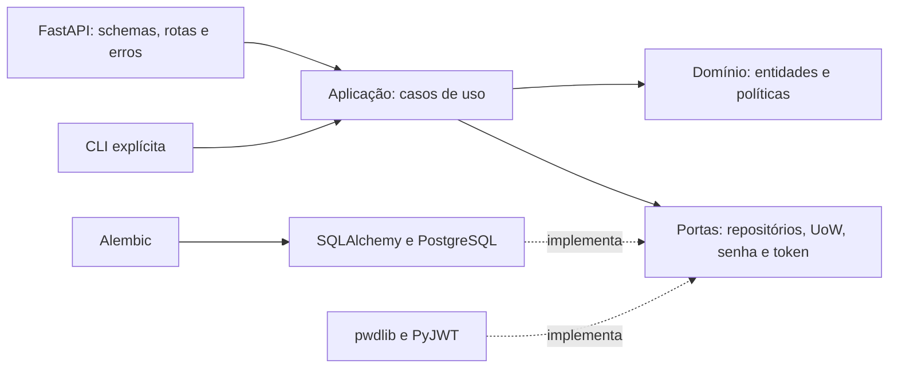
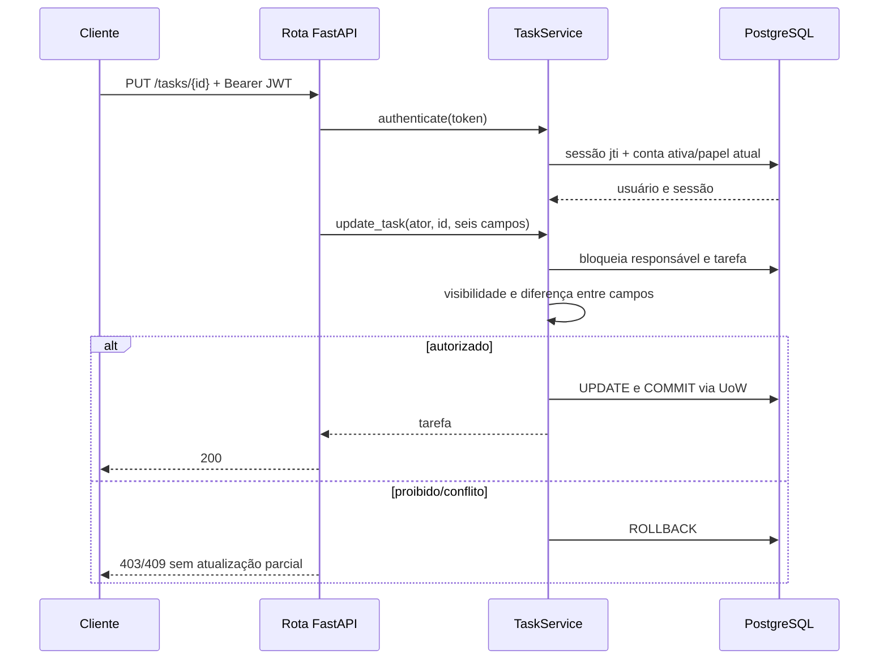

# Arquitetura

## Limites e dependências

O domínio usa apenas a biblioteca padrão. A aplicação conhece o domínio e suas portas, sem importar FastAPI, Pydantic ou ORM. As rotas validam o contrato HTTP, chamam `TaskService` e projetam respostas; `SqlUnitOfWork` liga repositórios ao `Session`. Os mapeamentos entre `User`/`Task`/`Comment` do domínio, linhas ORM e schemas Pydantic são explícitos.

`AppError` contém código semântico e mensagem controlada, sem status HTTP. A fronteira HTTP em `main.py` traduz códigos como `CONFLICT` para 409; a CLI traduz os mesmos erros em mensagem de terminal e código de saída 1. Isso permite reutilizar os casos de uso pelos dois adaptadores sem transportar detalhes de HTTP para as camadas internas. A CLI descarta o engine em um bloco `finally`, tanto no sucesso quanto na falha.

Repository encapsula consultas, inclusive o predicado de visibilidade aplicado no `WHERE` antes de `COUNT/LIMIT/OFFSET`. A UoW controla o commit; métodos de repositório não confirmam transações. Ao sair de uma UoW sem commit, ocorre rollback e fechamento da sessão. A factory cria uma `Session` por operação. A `create_app` injeta o factory, hash, codec JWT e relógio.

## Fluxo de autenticação e alteração

O token contém apenas identidade, jti e claims temporais. O papel atual e o estado da sessão vêm do banco em cada requisição protegida. Um logout altera `auth_sessions.revoked_at`, preservando a revogação após reinício.

## Concorrência e concessões

Mudanças de papel, exclusão de conta e bootstrap compartilham um advisory lock transacional PostgreSQL. A atribuição e a desativação bloqueiam a linha do usuário antes de alterar tarefas; assim, a desativação limpa atribuições abertas que já foram confirmadas, ou a atribuição encontra a conta desativada. O bloqueio é específico do adaptador, não do domínio. A consistência de `done`/`completed_at` também é reforçada por `CHECK` no banco.

A arquitetura mantém um serviço de aplicação único para reduzir arquivos no escopo de uma semana. Não há event bus, cache, repositório genérico ou transações distribuídas. Consultas de lista fazem `COUNT` e busca na mesma UoW, mas sob isolamento padrão `READ COMMITTED` os dois resultados podem refletir commits concorrentes distintos; não é um snapshot serializável de paginação.
