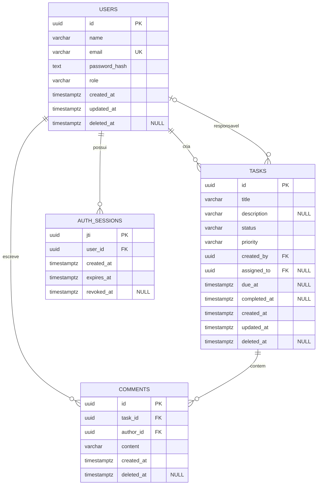

# Modelo relacional

`users.email` é único sem filtro de exclusão lógica: e-mail desativado não é reutilizado. `role`, `status` e `priority` usam colunas textuais com `CHECK` nomeados; a constraint `ck_tasks_completion` exige `completed_at` somente para `done`. FKs não têm cascata destrutiva. Datas usam `TIMESTAMP WITH TIME ZONE` e os adaptadores normalizam leituras para UTC.

Índices: unicidade em `users.email`; `ix_tasks_creator_live(created_by,created_at)` e `ix_tasks_assignee_live(assigned_to,created_at)` para visibilidade, `ix_tasks_filters_live(status,priority,due_at)` para filtros, todos parciais em tarefas não excluídas; `ix_comments_task_live(task_id,created_at,id)` parcial; `ix_sessions_user_expiry(user_id,expires_at)`. O Alembic em `0001_initial.py` é a fonte versionada do schema; `create_all` não participa da execução nem dos testes.
